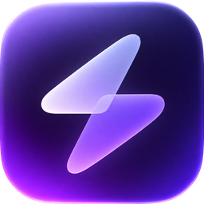
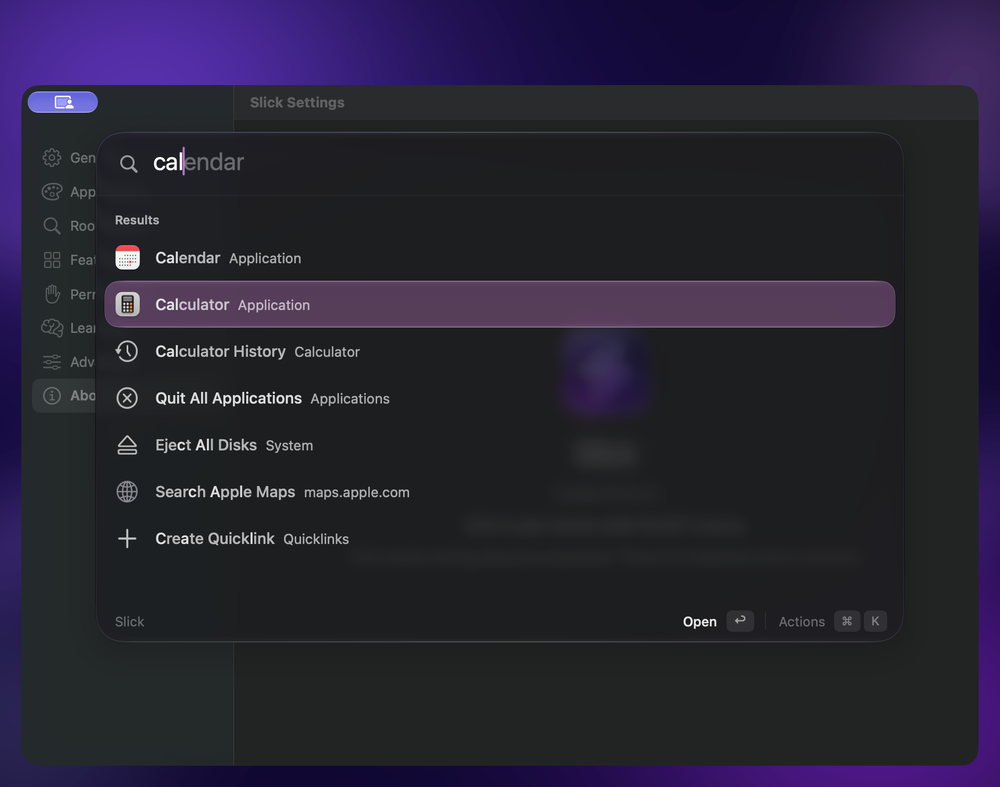
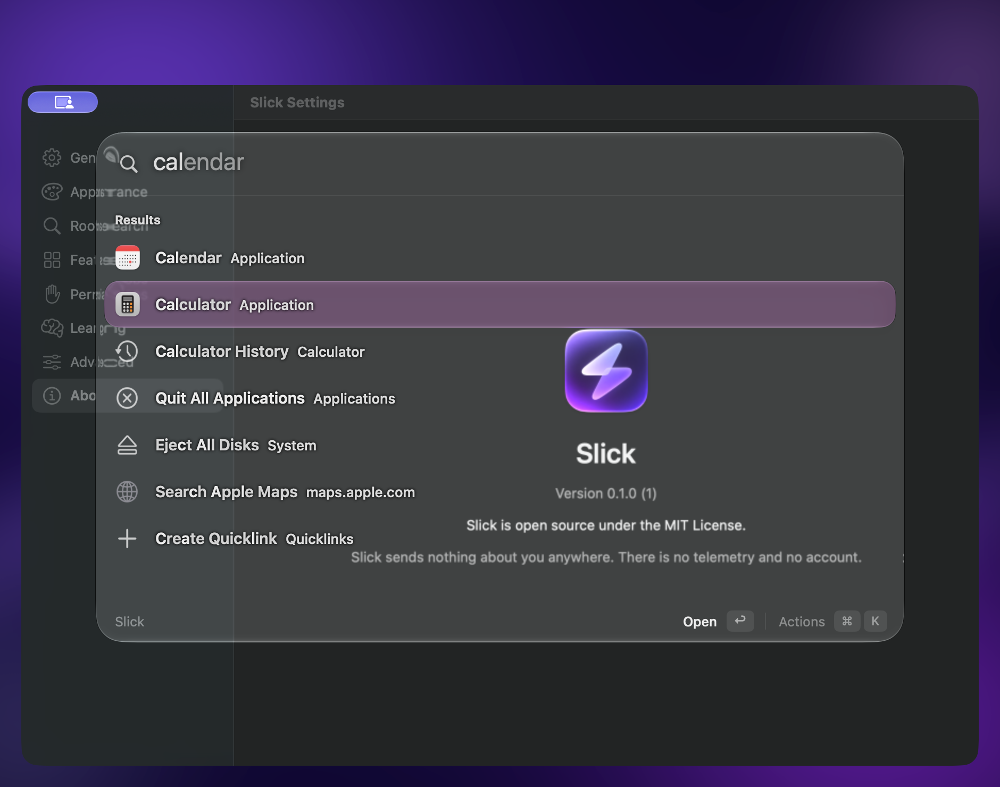
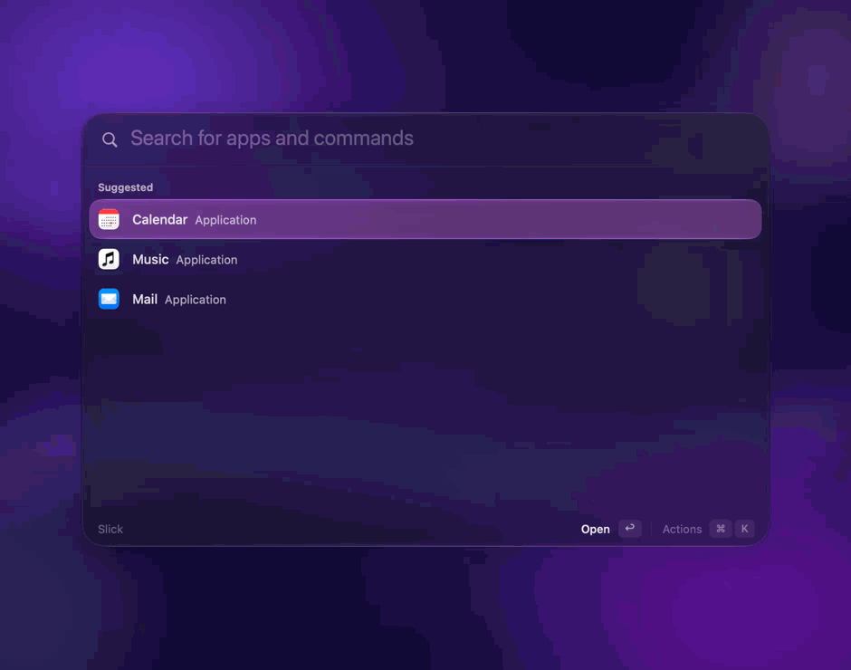

<div align="center">



<h1>Slick</h1>

<p><strong>An open-source macOS launcher in the class of Raycast and Alfred. Press a hotkey, type a few letters, and open the app, file, setting or command you meant. Slick draws its panel in the system's own Liquid Glass and learns which result you pick.</strong></p>

<picture>
  <source media="(prefers-color-scheme: dark)" srcset="site/media/hero-dark.gif">
  <source media="(prefers-color-scheme: light)" srcset="site/media/hero-light.gif">
  
</picture>

<sub>Two typed letters find Notes, and the field completes its name. Recorded from the assembled app with Apple's own apps.</sub>

<p><strong>Version 0.1.1 is out, and it is early.</strong> Install it with <code>brew install --cask shawntz/tap/slick</code>, or <a href="https://github.com/shawntz/slick/releases/latest">download it</a>. The assembled app passes all of its end-to-end scenarios against made-up data. The live launcher first ran on a real Mac on 16 November 2026, and most of its features have not been tried there yet.</p>

<p>
  <a href="#speed-measured-inside-the-app">Speed</a> ·
  <a href="#real-liquid-glass">Glass</a> ·
  <a href="#it-learns-what-you-pick">Learning</a> ·
  <a href="#every-feature-and-its-status">Features</a> ·
  <a href="#install">Install</a> ·
  <a href="#build-from-source">Build</a> ·
  <a href="#privacy">Privacy</a>
</p>

</div>

## What it does

### Speed, measured inside the app

Every path that runs while you type has a budget for main-thread time. `make bench` measures each one inside the release app, and in the latest run, with sixteen features registered, every budget passed.

<div align="center">


<sub>The list narrows with each letter, and the selection glides between rows.</sub>

</div>

| What was measured | Median | p99 | Budget |
|---|---|---|---|
| Root search over 3,146 items, with the engine's ranking | 0.026 ms | 0.070 ms | 0.5 ms at p99 |
| Root search over 10,146 items, with the engine's ranking | 0.041 ms | 0.134 ms | 1.5 ms at p99 |
| A keystroke over 3,146 items, from the field editor to the screen commit | 1.34 ms | 4.60 ms | 3 ms median, 5 ms p99 |
| A keystroke over 10,146 items, from the field editor to the screen commit | 1.42 ms | 4.73 ms | 3 ms median, 5 ms p99 |
| The launcher's own summon path, not counting the system making the panel key and drawing the glass's key look | 0.024 ms | 0.095 ms | 1 ms |
| Opening the action panel over 10,146 items | 1.77 ms | 3.44 ms | 8 ms at p99 |
| First pixels on screen after the summon call | 26.5 ms | 46.8 ms | none |

These numbers come from an Apple M5 with macOS 27.2 in November 2026. The release app ran through LaunchServices while other builds kept the load average between 3 and 8. Budgets count main-thread CPU time. First pixels count wall time to the first frame, measured in the app's recording build. In all 30 summons that first frame already showed the finished glass.

The keystroke margin is thin. Earlier the same day the same bench missed the 5 ms budget at 10,146 items, with a p99 of 5.58 ms. Nobody has measured other launchers on this Mac, so these numbers compare Slick only with its own budgets.

The [latency rules](docs/ARCHITECTURE.md#latency-rules) say how. No file, network or cross-process call may run on the main thread inside a keystroke. The Rust matcher checks bit masks before it scores a title, and it allocates no memory during a query.

### Real Liquid Glass

Slick draws the panel in `NSGlassEffectView`, the system's own Liquid Glass, not a blur imitation. Glass shows its full look only while its window is key. So Slick keeps a single key panel and draws the action panel, previews, confirmations and forms inside it. It makes the panel key before it shows it, so the first frame of a summon already has the finished look.

<table>
  <tr>
    <td width="50%" valign="top">
      <picture>
        <source media="(prefers-color-scheme: dark)" srcset="site/media/actions-dark.gif">
        <source media="(prefers-color-scheme: light)" srcset="site/media/actions-light.gif">
        
      </picture>
      <br><sub>Command-K opens the actions of the selected result inside the same glass, and typing filters them.</sub>
    </td>
    <td width="50%" valign="top">
      
      <br><sub>Switching themes restyles the open panel at once. The theme editor and sharing are still in progress.</sub>
    </td>
  </tr>
</table>

Two more built-in themes change the shape and the clarity of the glass. Pick one in Settings, under Appearance.

Spotlight is modeled on Spotlight in macOS 27. The query sits in a capsule of glass, and the results sit in a separate container below it.

<div align="center">

<picture>
  <source media="(prefers-color-scheme: dark)" srcset="site/media/clip-spotlight-dark.gif">
  <source media="(prefers-color-scheme: light)" srcset="site/media/clip-spotlight-light.gif">
  
</picture>

<sub>Typing "cal" narrows the results, and Command-K opens the action panel inside the results container. Each row shows the Command-digit shortcut that runs it.</sub>

</div>

Glass draws Standard's panel in the system's clear glass, its most translucent style, with no tint. Nothing frosts the window behind it, so the panel's text carries a soft halo instead. Over a busy or bright window, that text can be hard to read.

<div align="center">


<sub>The About page of Slick's settings window stays sharp behind the panel in the Glass theme.</sub>

</div>

<table>
  <tr>
    <td width="50%" valign="top">
      
      <br><sub>In the Standard theme, frosted glass blurs the window behind the panel.</sub>
    </td>
    <td width="50%" valign="top">
      
      <br><sub>In the Glass theme, the same window stays sharp through the panel.</sub>
    </td>
  </tr>
</table>

### It learns what you pick

Pick a lower result twice for the same query, and it becomes the first. One stray pick does not change it. A learned pick even outranks an exact title match, on purpose. Before you type, the same engine suggests what you are likely to open next from the time of day, the app in front and what you just used.

<div align="center">

<picture>
  <source media="(prefers-color-scheme: dark)" srcset="site/media/clip-learn-dark.gif">
  <source media="(prefers-color-scheme: light)" srcset="site/media/clip-learn-light.gif">
  
</picture>

<sub>Font Book is picked twice for "bo", and on the third search it is first, above Books.</sub>

</div>

### Calculator, clipboard, emoji and files

The app registers twenty-one feature packages. These clips show four of them in the assembled app. File search is still in progress, and the other three are available.

<table>
  <tr>
    <td width="50%" valign="top">
      
      <br><sub>The calculator answers as you type, and Return copies the answer.</sub>
    </td>
    <td width="50%" valign="top">
      
      <br><sub>Clipboard history shows what you copied and pastes it back. It stays off until you switch it on.</sub>
    </td>
  </tr>
  <tr>
    <td width="50%" valign="top">
      
      <br><sub>Search Emoji and Symbols opens a grid that filters as you type.</sub>
    </td>
    <td width="50%" valign="top">
      
      <br><sub>Search Files shows each match's kind, size, date and folder. It is proven over a sample index, and indexing real folders has not run on a Mac yet.</sub>
    </td>
  </tr>
</table>

### Every feature and its status

[support/features.json](support/features.json) is the one list of what Slick does and how far along each part is. `scripts/sync-features.py` writes the tables below from it, so they cannot claim more than the data does. Available means a scripted end-to-end scenario proves the feature in the assembled app, against made-up data. In progress means the code exists, and each line says what is proven and what has not run yet.

<!-- features:start -->
<!-- Generated by scripts/sync-features.py from support/features.json. Edit the JSON, then run the script. -->

As of 2026-11-16, 12 of 30 features are available and 18 are in progress.

#### Core

7 of these 9 are available and 2 are in progress.

| Available | What it does |
|---|---|
| Liquid Glass panel | A native macOS Liquid Glass panel. |
| Fuzzy search | Find results by partial name, abbreviation or typo. |
| Learns your habits | Choose a result twice for the same search to move it to the top. |
| Suggestions before you type | Get suggestions based on the time of day and the apps you use. |
| Apps and System Settings | Open, quit or reveal apps and jump to System Settings panes. |
| Hotkeys, aliases and favorites | Assign keyboard shortcuts and aliases, or pin items as favorites. |
| Action panel | Press Command-K for actions on the selected result. |

| In progress | What it does |
|---|---|
| Themes | Choose from seven themes and adjust the glass, colors and text size. Switching themes works in the launcher. The editor, sharing and the light or dark choice are not tested in the app yet. |
| Updates | Optional daily update checks. You choose when to install. Version 0.1.1 is the first update it offers to people who installed 0.1.0. |

#### Built-in tools

5 of these 21 are available and 16 are in progress.

| Available | What it does |
|---|---|
| Calculator | Calculate, convert units and currencies, and work with dates and time zones. Return copies the answer. |
| Clipboard history | Find and paste text, links, images and files you copied. |
| Quicklinks and web search | Open websites or search the web with a keyword. |
| Emoji picker | Find emoji and symbols by name, then paste them. |
| Notes | Write, search and organize notes saved as Markdown files. Proven in the launcher on real files in its own folder. A notes folder you choose in Documents or another folder macOS guards has not been read on a Mac yet. A floating note window is not part of it. |

| In progress | What it does |
|---|---|
| File search | Search files by name and browse folders. Proven in the launcher over a sample index. Indexing your real folders has not run on a Mac yet. |
| Snippets | Save text with placeholders and paste it when you need it. Expanding a keyword as you type in other apps has not run on a Mac yet. |
| Window management | Resize, center and move windows between displays. Proven against simulated windows. Moving real windows has not run on a Mac yet. |
| System commands | Lock or sleep your Mac, adjust volume, eject disks and quit processes. Proven against simulated services. The real system calls have not run on a Mac yet. |
| Script commands | Run scripts with arguments and view their output. The commands and their arguments are proven in the launcher. Running a real script has not been tested in the app. |
| Universal actions | Run actions on text or files selected in another app. The actions show for results in the launcher. Reading the selection in another app has not run on a Mac yet. |
| Dictionary | Look up definitions and check spelling. Proven in the launcher with sample entries. The Mac's own dictionaries have not been read in the app yet. |
| Calendar and reminders | Check your calendar, join meetings and create events or reminders. Proven with a sample day. Reading your real calendars has not run on a Mac yet. |
| Contacts | Find contacts to call, message or email. Proven with sample contacts. Reading your real contacts has not run on a Mac yet. |
| Browser bookmarks | Search and open bookmarks from Safari, Chrome and Firefox. Proven with sample bookmarks. Reading a real browser's files has not run on a Mac yet. |
| Menu items | Find and run menu commands in the current app. Proven with a sample app's menus. Reading a real app's menus has not run on a Mac yet. |
| AI | Ask questions using Apple’s on-device model or a provider you configure. Proven in the launcher with a simulated model. A real model has not answered yet. |
| Shell commands | Type > to run a shell command and see its output. Proven in the launcher against a simulated shell. Running a real command has not been tested in the app. |
| Color picker | Pick colors from your screen, convert color values and check contrast. Conversions, contrast and the history work in the launcher. Picking from the screen has not run on a Mac yet. |
| Translate | Translate text using languages installed on your Mac. Proven in the launcher with a simulated engine. Apple's Translation framework has not run in the app yet. |
| Media controls | Play, pause and skip tracks in Music and Spotify. Proven in the launcher against a simulated player. Controlling the real apps has not run on a Mac yet. |

<!-- features:end -->

## Install

```sh
brew install --cask shawntz/tap/slick
```

Or download `Slick-0.1.1.zip` from the [latest release](https://github.com/shawntz/slick/releases/latest), unzip it and move Slick to your Applications folder.

The app is signed with a Developer ID and notarized by Apple. It needs macOS 26 or later on Apple silicon, and it has been tested only on macOS 27. Once you agree, it checks GitHub once a day for a new version and installs one only when you choose to.

## Build from source

You need macOS 27 with Xcode 27, and rustup, which `brew install rustup` installs. It fetches the Rust version pinned in [rust-toolchain.toml](rust-toolchain.toml) on first use.

```sh
git clone https://github.com/shawntz/slick.git
cd slick
make bootstrap   # check Xcode and the SDK, build the Rust core, resolve the Swift packages
make run         # build build/Slick.app and open it
```

The app runs on macOS 26 or later on Apple silicon. It is developed and tested on macOS 27, and macOS 26 is untested. `make test` runs every Rust and Swift test, `make selftest` checks the built app without showing a window, and `make help` lists every other target.

`make app` signs with your Apple Development identity when your keychain has one, and ad hoc otherwise. macOS drops permission grants such as Accessibility after each ad hoc rebuild, so a development certificate saves you from granting them again.

### Your first launch

Slick has no Dock icon. A bolt appears in the menu bar, and the onboarding window opens. Its six steps are Welcome, Hotkey, Optional Features, Permissions, Theme and Done.

- ⌘Space is the default hotkey. On a new Mac, ⌘Space opens Spotlight, and the Hotkey step tells you so. When you press Continue, Slick turns off Spotlight's shortcut and takes ⌘Space. To keep ⌘Space for Spotlight, record another hotkey before you press Continue. While ⌘Space still opens Spotlight, the General pane in settings and the bolt menu offer Turn Off Spotlight's Shortcut, which does the same.
- If another macOS shortcut uses your keys, turn it off in System Settings, under Keyboard. Slick waits until the keys are free. Until then, Open in the bolt menu opens the launcher.
- Clipboard History and File Search start off. The Optional Features step lists both. Clipboard History's switch starts off there, and File Search's starts on because onboarding suggests it. Neither switch takes effect until you press Continue.
- Slick asks macOS for no permission at launch. The Permissions step lists only what the features you kept on can need, and asks macOS only when you press Allow. The rows sit under four headings, Typing and Pasting, Files and Folders, Calendar and Contacts, and Other Apps. Full Disk Access comes first under Files and Folders, because allowing it also allows the folders below it except iCloud Drive. You can skip every row. Each feature asks again through a card in the panel the first time you run something that needs it.

This is what the code does. Onboarding was first walked on a real Mac on 16 November 2026, and most features have not been tried there yet. [docs/FIRST-LAUNCH.md](docs/FIRST-LAUNCH.md) has the full walk. It lists every permission and when it is asked, what Slick reads and stores, and how to try each feature safely.

Inside the panel, Command-K opens the actions of the selected result. The [keyboard table](docs/ARCHITECTURE.md#host) lists every other key.

## How it is built

Swift 6 and AppKit draw the panel and run the features. A Rust core does the matching, ranking, learning, math and file indexing. It links in as one static library behind a C ABI, and only the CoreBridge package sees its header.

| Part | Where | What it does |
|---|---|---|
| Rust core | [core/](core) | Matcher, learning model, ranking engine, calculator and file index |
| Kit | [Packages/Kit](Packages/Kit) | The contracts every feature is written against, with a fake for every service |
| LauncherUI | [Packages/LauncherUI](Packages/LauncherUI) | AppKit drawing: the glass panel, query field, Core Text list, grid, detail pane and forms |
| Host | [Packages/Host](Packages/Host) | The feature runtime, navigation, the action panel and the keyboard model |
| Root | [Packages/Root](Packages/Root) | Root search: engine queries, suggestions, favorites, aliases and learning |
| Platform | [Packages/Platform](Packages/Platform) | Live system services such as hotkeys, the pasteboard, icons and permissions |
| SettingsUI | [Packages/SettingsUI](Packages/SettingsUI) | The settings window and onboarding |
| Features | [Packages/Features](Packages/Features) | Twenty-one packages, one per feature |
| App | [Packages/App](Packages/App) | The executable that joins the rest |

Each module is its own package, so a syntax error in one feature cannot stop another feature's tests. In the latest full run, 278 Rust tests and all 30 Swift packages passed with warnings as errors, and all 66 scenarios passed headless. CI runs the selftest of the bundled app on every push. [docs/ARCHITECTURE.md](docs/ARCHITECTURE.md) is the contract for the layout, the dependency rules, the ranking contract and the latency and glass rules.

### Write a feature

A feature is one Swift package under `Packages/Features` that depends on Kit. It describes its commands, rows, pages and settings as data, and the host draws them. Every side effect goes through a service on the feature's context, so the same code runs against the Mac in the app and against fakes in tests. This is the smallest one in the guide:

```swift
import Foundation
import Kit

final class UUIDFeature: Feature {
    static let manifest = FeatureManifest(id: "uuid", name: "UUID", icon: .symbol("number"))

    init(context: FeatureContext) {}

    var commands: [Command] {
        [
            Command(id: "copy-uuid", title: "Copy UUID", icon: .symbol("doc.on.doc")) { context in
                await context.pasteboard.copy(UUID().uuidString)
                return .close(hud: "Copied UUID")
            }
        ]
    }
}
```

One line in [Features.swift](Packages/App/Sources/SlickApp/Features.swift) registers a feature with the app. [docs/FEATURES.md](docs/FEATURES.md) walks through this feature, a searchable list and a full bookmarks feature, which all compile and run as tests. Then it covers every part of Kit and the rules that keep a feature fast.

## Privacy

Slick has no account and no telemetry. What it learns stays on your Mac. Apart from system commands you run, such as Toggle Dark Mode, Slick changes one system setting, Spotlight's keyboard shortcut, and turns it off only when you press Continue on the Hotkey step or choose Turn Off Spotlight's Shortcut in settings or the bolt menu.

### What is stored, and where

Everything lives in `~/Library/Application Support/Slick`. Settings go to the app's own preferences.

- `app.root` holds what the launcher learns, as a snapshot and an append-only event log.
- `Features/<feature>` holds each feature's own files, such as snippets, quicklinks, your scripts and AI chats. The clipboard history database appears there only once you switch Clipboard History on.
- `Caches` holds the icon cache, and `Themes` holds your own themes and your changes to the built-in ones.
- `launcher.lock` marks the one running copy.

Clipboard history never stores items an app marks as concealed, transient or auto-generated. File search, once you switch it on, indexes the names and dates of the files in your home folder and never reads their contents. It skips Library and packages such as apps, and it leaves out Desktop, Documents, Downloads and iCloud Drive until you include them.

<div align="center">

<picture>
  <source media="(prefers-color-scheme: dark)" srcset="site/media/settings-learning-dark.png">
  <source media="(prefers-color-scheme: light)" srcset="site/media/settings-learning-light.png">
  
</picture>

<sub>The Learning pane shows what was learned on this Mac. It can forget an item, pause learning or erase everything.</sub>

</div>

### What leaves the Mac, and when

Nothing leaves at launch unless you turned on update checks. Slick makes a network request only when you ask for something that needs one, or for the update check you agreed to:

- a check for a new version, once a day in a release build after you turn on Check for Updates Automatically, and whenever you choose Check for Updates. It asks GitHub for the latest release's feed. The request carries the version numbers of Slick and its updater and, like any web request, your IP address.
- a web search
- a shell command or script you run that uses the network
- a currency conversion, which downloads exchange rates
- a question to an AI provider you set up
- web icons for script commands, which start off

Slick asks for no permission at launch either. It asks for each one only after you press a button: Allow in onboarding or in settings, or the button on the panel's permission card. The one exception is Local Network, which macOS asks for by itself the first time Slick connects to an AI model server on another machine. No feature uses Location, the camera, the microphone, Screen Recording or Focus.

A shell command you run has every permission you gave Slick, such as Accessibility and Full Disk Access, and macOS asks in Slick's name for anything more. A command that needs the camera, the microphone or Bluetooth may be refused. Run that one with Open in Terminal.

The tests use made-up data. They never read your pasteboard, walk your home folder or make a network request.

To erase everything, quit Slick from the bolt menu, move `~/Library/Application Support/Slick` to the Trash and run `defaults delete com.shawnschwartz.slick`. Permissions you granted stay with the app until you remove them in System Settings. If Slick turned off Spotlight's shortcut, it stays off until you turn it on again in System Settings, under Keyboard.

## Contributing

Read [CONTRIBUTING.md](CONTRIBUTING.md), then [docs/ARCHITECTURE.md](docs/ARCHITECTURE.md). CI runs `make lint`, every test and the selftest on every push to main and every pull request. If you change [support/features.json](support/features.json), run `scripts/sync-features.py`. It rewrites the tables in this README and the feature list on the website, and `--check` fails when either is stale. Report a security problem privately, as [SECURITY.md](SECURITY.md) says.

## License

MIT. See [LICENSE](LICENSE).

Spotlight is a trademark of Apple Inc. Slick is not affiliated with Apple.

---

The website will be at [slick.computer](https://slick.computer).

<sub>Slick follows Raycast and Alfred, and credits them for the ideas it builds on.</sub>
