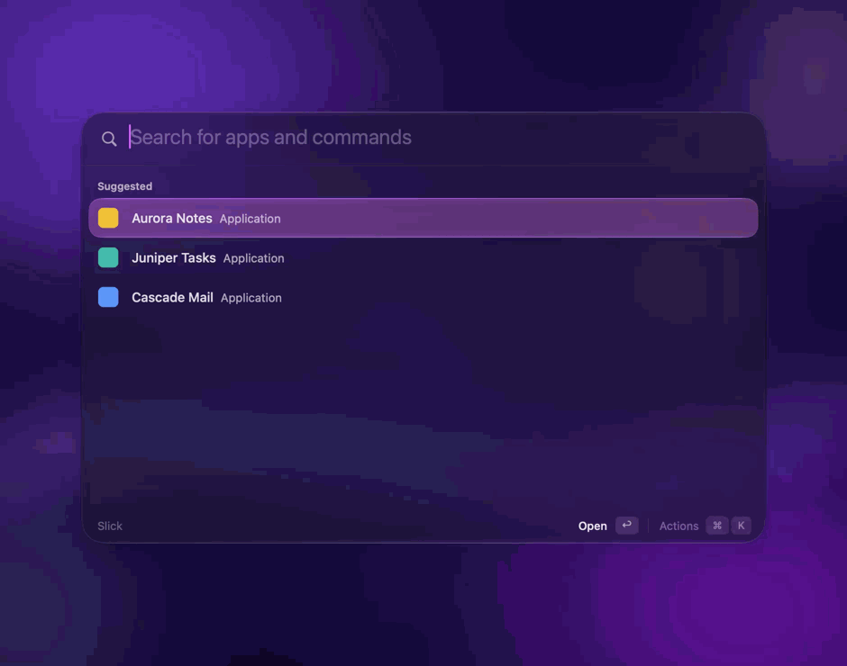
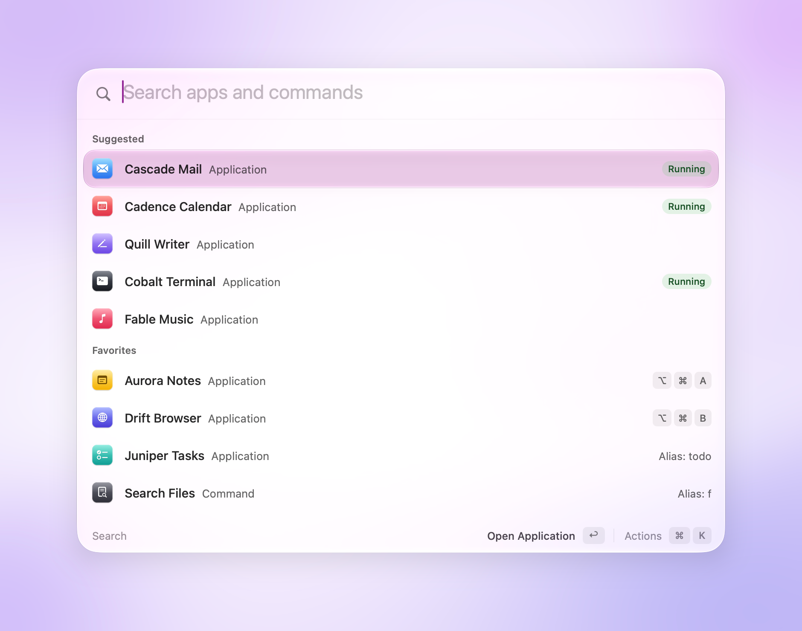
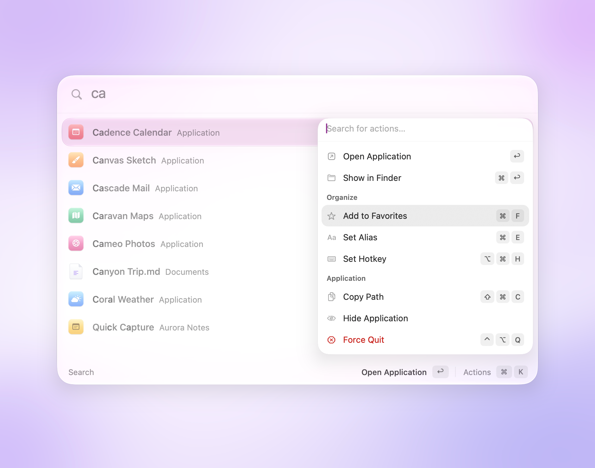
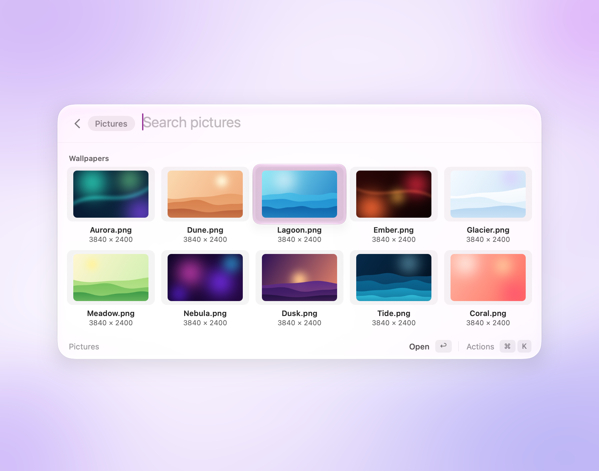

<div align="center">


<h1>Slick</h1>

<p><strong>A native macOS launcher that puts everything on your Mac behind one hotkey and one search field.</strong></p>

<p>MIT license · macOS 26 or later on Apple silicon, tested on macOS 27 · Swift 6 and Rust</p>

<p>
  <a href="#speed-is-budgeted-and-measured">Speed</a> ·
  <a href="#the-glass-is-real">Glass</a> ·
  <a href="#it-learns-and-the-learning-stays-local">Learning</a> ·
  <a href="#features">Features</a> ·
  <a href="#build-from-source">Build</a> ·
  <a href="#how-it-works">How it works</a>
</p>

</div>

> [!NOTE]
> **Slick is pre-release, and there is no download yet.** It builds from source into one app that passes its own end-to-end scenarios. Nobody has used it as a daily launcher yet, so expect rough edges. The [feature list](#features) says what is proven and what is not.

Every part of Slick, including the Rust matcher and the glass panel, is MIT-licensed code in this repository. The app has no account, no telemetry and no subscription. It is built to be the fastest launcher on the Mac, so its speed budgets are written down and tested.

<div align="center">

<picture>
  <source media="(prefers-color-scheme: dark)" srcset="site/media/hero-dark.gif">
  <source media="(prefers-color-scheme: light)" srcset="site/media/hero-light.gif">
  
</picture>

<sub>Two typed letters find the app, the field completes its name, and Return opens it.<br>The assembled app, recorded while it ran a scripted scenario over made-up sample apps.</sub>

</div>

## Speed is budgeted and measured

On an Apple M5, a root search over about 3,100 items takes 22 µs at the median and 53 µs at p99, ranking included. The Rust matcher keeps each catalog in one flat arena of folded text. A query checks bit masks and NEON bitmaps first, and scores only the titles that pass them. The engine allocates no memory during a query.

The [latency rules](docs/ARCHITECTURE.md#latency-rules) cover the rest of the path:

- No file, network or cross-process call runs on the main thread inside a keystroke.
- The summon path only shows the panel and makes it key. The panel stays ordered in, and showing it flips one layer's opacity.
- One Core Text view draws every visible result row. Nothing that updates per keystroke uses SwiftUI or `NSTableView`.

Measured on an Apple M5 with macOS 27.2 and a 120 Hz display, release builds, November 2026. The budgets are main-thread CPU time, measured inside the app bundle launched through LaunchServices, where the main thread often runs on efficiency cores. The app had its eight built-in features registered.

| What was measured | Result |
|---|---|
| Root search over 3,113 items, ranking included | 22 µs median, 53 µs p99 |
| Root search over 10,113 items | 34 µs median, 104 µs p99 |
| The launcher's own work on the summon path, not counting the system making the window key | 0.02 ms median, 0.04 ms p99 |
| First pixels after the summon call | 8.5 ms median, 14 ms p99 |
| Opening the action panel | 1.6 to 1.9 ms median, 2.7 ms p99 |
| Main-thread work per keystroke, whole panel | 1.3 ms median, 4.8 to 5.8 ms p99 |

The keystroke budget is 3 ms at the median and 5 ms at p99. Slick meets the median. Its p99 lands between 4.8 and 5.8 ms from run to run, so it does not hold the p99 budget yet. Most of that tail is drawing the rows and the Core Animation commit.

The window server adds one to two display refreshes to any change on screen. That makes the realistic time from key press to a changed screen about 17 ms at the median on a 120 Hz display. This is a system floor, and it applies to every app.

`make bench` prints these tables from the app bundle. `make bench-core` and the LauncherUI budget tests exit with an error when a budget is blown. Nobody has measured other launchers on this machine, so these numbers compare Slick only with its own budgets.

## The glass is real

The panel is one `NSGlassEffectView`, the system's own Liquid Glass. Glass shows its full look only while its window is key. So Slick keeps a single key panel and draws everything that would need a second window inside it, such as menus, previews, confirmations and forms. The pictures and clips in this README are ScreenCaptureKit captures of that glass.

## It learns, and the learning stays local

A result you pick twice for a query becomes the top hit for that query. One stray pick does not change it. A learned pick outranks an exact title match on purpose. In the engine's tests, picking Terminal twice for `term` makes Terminal win `term` even when another app is named Term.

Slick writes what it learns to an append-only log on your Mac. The log survives the app being killed at any byte, and startup with 50,000 learned events takes 1 to 2 ms. The settings window shows what Slick learned, and it can forget an item, pause learning or erase everything.

Learning sits on top of a matcher written for launcher queries. It understands prefixes, acronyms, camelCase, word order and typos, so `gc` finds Google Chrome and `calender` finds Calendar. On a held-out set of 45 query expectations written before tuning, it passes 42.

## It is yours to change

Each feature is its own Swift package, written against Kit, the contract layer, and the app registers it with one line. A feature describes its commands, rows, pages and settings as data. The host draws them, and every side effect goes through a service that tests replace with a fake. [docs/FEATURES.md](docs/FEATURES.md) walks through three complete examples that compile and run as tests.

A theme holds every color, font and metric the panel uses, and it saves and loads as one JSON file you can share. A clip under [Screenshots](#screenshots) switches between the built-in themes.

## Screenshots

The clips are recordings of the assembled app: its real search, ranking, learning, features and glass, run as scripted scenarios over made-up sample apps. In that mode opening an app is recorded instead of done, and the app never reads real app icons, so the sample apps show plain colored squares. `make media` records them again from [scenarios/media](scenarios/media).

<table>
  <tr>
    <td width="50%">
      <picture>
        <source media="(prefers-color-scheme: dark)" srcset="site/media/actions-dark.gif">
        <source media="(prefers-color-scheme: light)" srcset="site/media/actions-light.gif">
        
      </picture>
      <br><sub>Command-K opens the action panel for the selected result, and typing filters it.</sub>
    </td>
    <td width="50%">
      
      <br><sub>Pick the second result twice, and it becomes the first.</sub>
    </td>
  </tr>
  <tr>
    <td width="50%">
      
      <br><sub>The list narrows as the query grows, and the selection glides between rows.</sub>
    </td>
    <td width="50%">
      
      <br><sub>Switching themes restyles the open panel at once.</sub>
    </td>
  </tr>
</table>

The stills below are older. The interface code drew them on its own over the same wallpaper and sample catalog. Each one follows your GitHub theme, dark or light.

<table>
  <tr>
    <td width="50%">
      <picture>
        <source media="(prefers-color-scheme: dark)" srcset="site/media/suggestions-dark.png">
        <source media="(prefers-color-scheme: light)" srcset="site/media/suggestions-light.png">
        
      </picture>
      <br><sub>Before you type, the panel lists suggestions and your favorites.</sub>
    </td>
    <td width="50%">
      <picture>
        <source media="(prefers-color-scheme: dark)" srcset="site/media/actions-dark.png">
        <source media="(prefers-color-scheme: light)" srcset="site/media/actions-light.png">
        
      </picture>
      <br><sub>Command-K opens the action panel for the selected result, with keyboard shortcuts beside the actions.</sub>
    </td>
  </tr>
  <tr>
    <td colspan="2" align="center">
      <picture>
        <source media="(prefers-color-scheme: dark)" srcset="site/media/grid-dark.png">
        <source media="(prefers-color-scheme: light)" srcset="site/media/grid-light.png">
        
      </picture>
      <br><sub>A folder of pictures shown as a grid of thumbnails.</sub>
    </td>
  </tr>
</table>

## Keyboard

<kbd>Command-Space</kbd> opens Slick by default. Spotlight holds that shortcut on a new Mac, so onboarding first walks you through turning off Spotlight's shortcut in System Settings. The keys that work inside the panel are in the keyboard table of [docs/ARCHITECTURE.md](docs/ARCHITECTURE.md#host).

## Features

[support/features.json](support/features.json) is the one list of what Slick does and how far along each part is. The tables below are generated from it, so these tables cannot claim more than the data does. Available means an end-to-end scenario proves the feature in the assembled app. In progress means the code exists and its live path is not proven yet, such as moving a real window or expanding text in another app. Planned means it is on the list.

<!-- features:start -->
<!-- Generated by scripts/sync-features.py from support/features.json. Edit the JSON, then run the script. -->

As of 2026-11-15, 9 of 19 features are available, 9 are in progress and 1 is planned.

### Core

| Available | What it does |
|---|---|
| Liquid Glass panel | A real system glass panel, not a blur imitation, with a selection lens that glides between rows. |
| Fuzzy search | An in-house matcher that understands prefixes, acronyms, camelCase, word order and typos. |
| Learns your habits | Pick a result twice for a query and it becomes the top hit. Everything it learns stays on your Mac. |
| Apps and System Settings | Open, quit, hide or reveal any app, and jump straight to a System Settings pane. |
| Hotkeys, aliases and favorites | Give any item a global hotkey or a short alias, and pin favorites to the top. |
| Action panel | Every result has more actions behind Command-K, with their own shortcuts. |

| In progress | What it does |
|---|---|
| Suggestions before you type | Ranks what you are likely to open next from the time of day, the app in front and what you just used. |
| Themes | Change tint, clarity, lens style, accent, text size and row height live, then save and share the theme as a file. |

### Built-in tools

| Available | What it does |
|---|---|
| Clipboard history | Search text, links, images and files you copied, and paste them back. |
| Quicklinks and web search | Open sites and searches with a keyword, and fall back to the web when nothing local matches. |
| Emoji picker | Search emoji and symbols by name and paste them. |

| In progress | What it does |
|---|---|
| File search | An own index of file names that answers in milliseconds, with folder browsing and previews. |
| Calculator | Math, percentages, units, currencies, dates and time zones, answered as you type. |
| Snippets | Saved text with placeholders that expands when you type a keyword in any app. |
| Window management | Halves, thirds, quarters, centering and moving windows between displays. |
| System commands | Sleep, lock, empty the Trash, toggle dark mode, eject disks and more. |
| Script commands | Run your own scripts from the launcher, with arguments and live output. |
| Universal actions | Act on the text or files selected in any app. |

| Planned | What it does |
|---|---|
| AI, with your own key | Ask questions with Apple's on-device model or a provider you configure. Nothing is sent unless you ask. |

<!-- features:end -->

## Build from source

You need macOS 27 with Xcode 27, and Rust stable. `make bootstrap` checks Xcode and the macOS SDK, and rustup installs the toolchain pinned in [rust-toolchain.toml](rust-toolchain.toml) on first use.

```sh
git clone https://github.com/shawntz/slick.git
cd slick
make bootstrap   # check toolchains, build the Rust core, resolve packages
make app         # build and bundle build/Slick.app
make test        # every Rust and Swift test
make selftest    # start the app in self-test mode and exit
```

The app runs on macOS 26 or later on Apple silicon. It is developed and tested on macOS 27, and macOS 26 is untested. `make run` builds the app and starts the launcher. `make help` prints every other target.

`make app` signs with your Apple Development identity when your keychain has one, and ad hoc otherwise. macOS drops permission grants such as Accessibility after each ad hoc rebuild, so a development certificate saves you from granting them again.

## How it works

Swift and AppKit draw the panel and run the features. A Rust core does the matching, ranking, learning, math and file indexing behind one C library, and only one Swift package sees its header.

| Part | Where | What it does |
|---|---|---|
| Rust core | [core/](core) | Matcher, learning model, ranking engine, calculator and file index, built as one static library with a C ABI |
| CoreBridge | [Packages/CoreBridge](Packages/CoreBridge) | Swift wrappers over the C ABI |
| Kit | [Packages/Kit](Packages/Kit) | The contracts every feature is written against: values, views, services and test fakes |
| LauncherUI | [Packages/LauncherUI](Packages/LauncherUI) | AppKit drawing: the glass panel, query field, Core Text list, grid, detail pane, forms and themes |
| Host | [Packages/Host](Packages/Host) | The feature runtime, navigation, the action panel and the keyboard model |
| Root | [Packages/Root](Packages/Root) | Root search: engine queries, suggestions, favorites, aliases and learning |
| Platform | [Packages/Platform](Packages/Platform) | Live system services: hotkeys, pasteboard, icons, permissions and the frontmost app |
| SettingsUI | [Packages/SettingsUI](Packages/SettingsUI) | The settings window, onboarding and the learning inspector |
| Features | [Packages/Features](Packages/Features) | One package per feature |
| App | [Packages/App](Packages/App) | The executable that connects everything else |

Each module is its own package, so a syntax error in one feature cannot stop another feature's tests. [docs/ARCHITECTURE.md](docs/ARCHITECTURE.md) is the contract for the layout, the dependency rules, the ranking rules and the latency and glass rules. [docs/FEATURES.md](docs/FEATURES.md) shows how to write a feature.

## Privacy

- There is no account and no telemetry.
- It makes no network request unless a feature you invoked needs one, such as currency rates for the calculator.
- What it learns stays in `~/Library/Application Support/Slick`. The learning inspector in settings shows it and can erase it.
- The tests use synthetic data. They never read your pasteboard, walk your home folder or make a network request.

## Contributing

Read [CONTRIBUTING.md](CONTRIBUTING.md), then [docs/ARCHITECTURE.md](docs/ARCHITECTURE.md). A new feature is a new package under `Packages/Features`, registered by one line in the app. CI runs `make lint`, every test and the self-test on each pull request. If you change [support/features.json](support/features.json), run `scripts/sync-features.py`. It rewrites the tables in this README, the static feature list in `site/index.html` and the site's copy of the data, and `--check` fails when any of them is stale.

## License

MIT. See [LICENSE](LICENSE).

---

<sub>Slick follows Raycast and Alfred, and credits them for the ideas it builds on.</sub>
